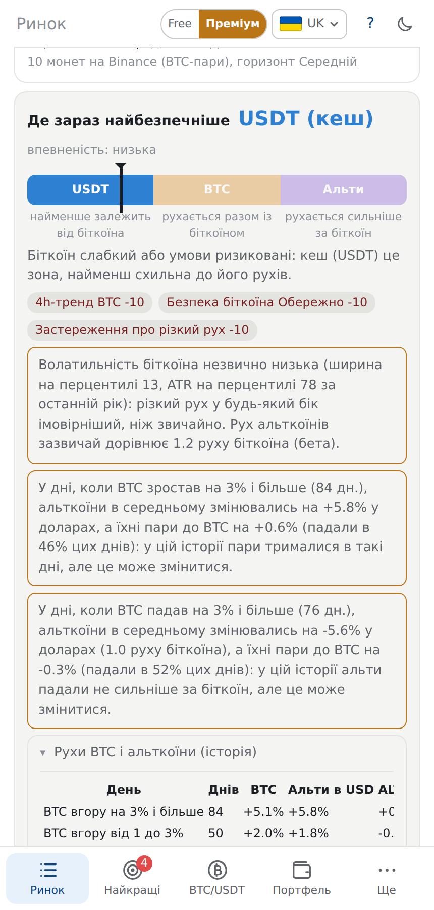
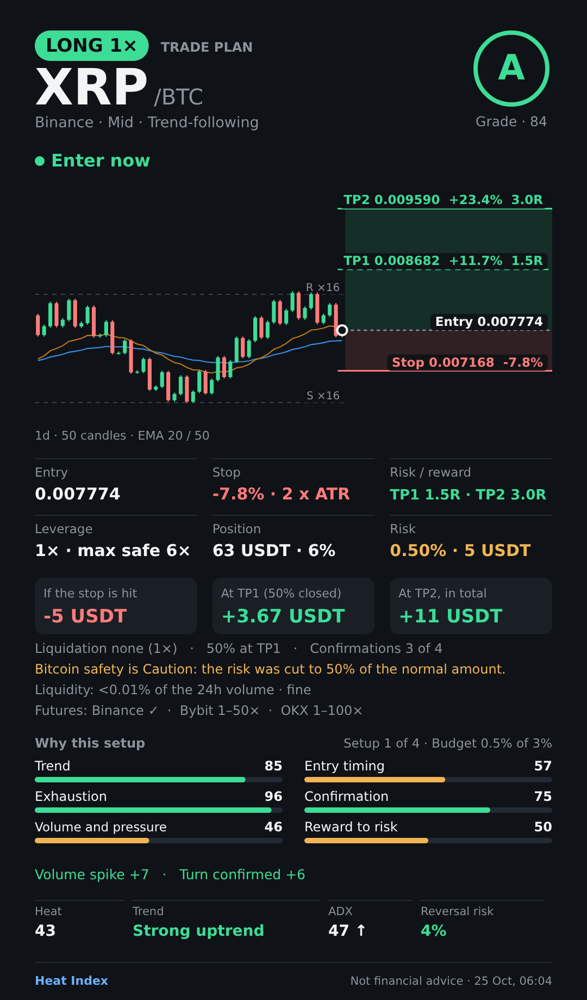
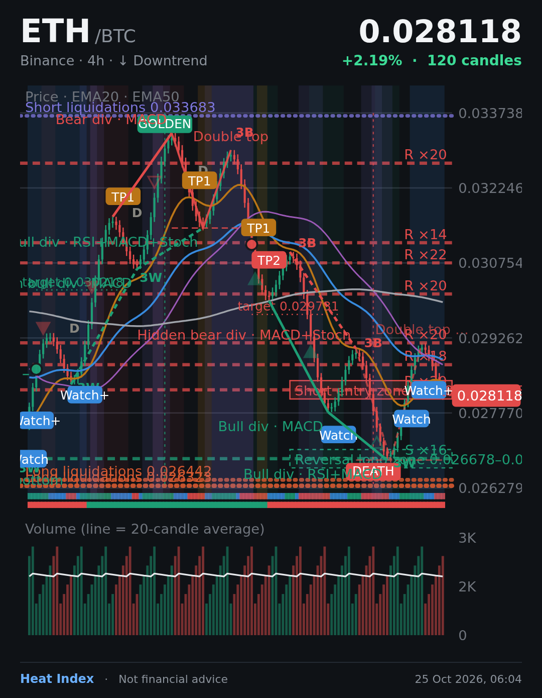

# Heat Index

Сканер крипторинку в одному HTML-файлі: без акаунта, без збірки, без сервера для самого застосунку. Показує, які монети перегріті чи перепродані, куди йде тренд, які ідеї угод є найкращими та де зараз найменше залежати від рухів біткоїна.
*A single-file crypto market scanner (no account, no build). Open `index.html` in a browser.*

> **Це інструмент аналізу, а не фінансова порада.** Heat, оцінки, плани угод і сигнали це оцінки за правилами, а не прогнози, і їхню прибутковість не доведено. Торгівля криптовалютою, особливо з плечем, може призвести до втрати всіх вкладених грошей. Угоди в розділі «Мої угоди» імітовані: жоден наказ не надсилається на біржу.



## Що вміє

- **Heat 0–100** для трьох горизонтів (Short 15m+1h, Mid 4h+1d, Long 1d+1w), зони купівлі й продажу, час у зоні, підтвердження розвороту, тренд, фаза ринку, ризик розвороту, прогноз.
- **Біржі** Binance, Bybit, OKX; пари до BTC і USDT; дані з публічних API прямо з вашого браузера.
- **Патерни й рівні:** дивергенції, свічкові патерни, подвійна вершина й дно, Фібоначчі, профіль обсягу, золотий і смертельний хрести, ADX, стискання Bollinger, Stochastic RSI; статистика точності й шанс спрацювання в підказках.
- **Найкращі угоди:** вхід, стоп, два тейк-профіти, розмір позиції, плече, ліквідність і перевірка книги заявок, оцінки A/B/C та їхня перевірка на історії.
- **Біткоїн і альткоїни:** глобальний тренд, безпека, домінація, індекс страху й жадібності, шкала зон USDT / BTC / альти з дослідженням кореляції та застереженнями про різкі рухи.
- Фільтри, сортування, пресети, таблиця, графіки з шарами, портфель, віртуальні угоди, симулятор, знімки картки, графіка й угоди, експорт CSV, резервна копія налаштувань.
- Мови: українська, англійська, російська; світла й темна тема. Перемикач **Free / Premium** показує, як могли б розділитись плани (нічого не продається).

|  |  |
|---|---|
|  |  |

## Швидкий старт

Відкрийте `index.html` у браузері (подвійний клік). Нічого встановлювати не треба. Усі ваші налаштування, закріплення, сповіщення й угоди зберігаються лише в цьому браузері; їх можна вивантажити файлом у **Налаштування → Резервна копія та дані**.

### Публікація на GitHub Pages

1. Створіть репозиторій і завантажте цей проєкт (команди нижче).
2. **Settings → Pages → Build and deployment → Source: GitHub Actions**.
3. Після першого `push` у гілку `main` робочий процес `.github/workflows/pages.yml` запустить перевірки та опублікує сайт за адресою `https://<ваш-логін>.github.io/<репозиторій>/`.

```bash
git init -b main
git add .
git commit -m "Heat Index: first version"
git remote add origin https://github.com/<ваш-логін>/<репозиторій>.git
git push -u origin main
```

Зауваження: на безкоштовному плані GitHub Pages працює лише для **публічних** репозиторіїв (код буде видно всім). Сторінка на Pages відкривається по **https**, тому браузер не дозволить їй звертатися до вашого сервера сповіщень за адресою `http://…` (виняток `localhost`). Дайте серверу https-адресу (зворотний проксі, Cloudflare Tunnel, Tailscale Funnel тощо) або відкривайте `index.html` локально.

## Сервер сповіщень (необов'язково)

Сторінка сповіщає, лише поки відкрита. Щоб сигнали приходили, коли її закрито, запустіть маленький сервер на комп'ютері, який працює постійно (домашній ПК, Raspberry Pi, VPS). Node.js 18+, без залежностей:

```bash
# сповіщення на телефон через ntfy
NTFY_TOPIC=довга-випадкова-назва node server/heat-server.js

# повідомлення в Telegram
TELEGRAM_BOT_TOKEN=123456:ABC... TELEGRAM_CHAT_ID=123456789 node server/heat-server.js

# обидва канали одночасно
NTFY_TOPIC=... TELEGRAM_BOT_TOKEN=... TELEGRAM_CHAT_ID=... node server/heat-server.js
```

**Telegram:** створіть бота в `@BotFather` (команда `/newbot`) і візьміть токен; відкрийте бота й натисніть Start (для групи чи каналу додайте бота й напишіть повідомлення). Не знаєте chat id? Запустіть сервер лише з токеном: він надрукує чати, які бачить бот, і зупиниться. Потім у застосунку: **Налаштування → Push, коли сторінку закрито**, вкажіть адресу сервера (за потреби `TOKEN` для захисту) і додайте сповіщення на монетах.

Інші змінні: `NTFY_SERVER`, `PORT` (8787), `INTERVAL` (60 с), `TOKEN`, `TREND`, `STATE_FILE`. Докладно у заголовку `server/heat-server.js`. **Токени й теми ніколи не додавайте в репозиторій**: передавайте їх змінними середовища.

## Перевірки

```bash
npm test      # або: node tests/smoke.js
```

Перевіряє, що скрипт сторінки розбирається, чисте ядро дає точні відповіді на малих прикладах (Heat у межах 0–100, бета й кореляція альта, зони шкали, перевірка файлів резервної копії, книга заявок, перевірка угоди), що **сервер бачить той самий Heat, що й застосунок** (в обох окремі копії аналізу; 576 порівнянь), і що в репозиторій не потрапив токен чи ключ.

## Перед публікацією

- Впишіть контактну адресу в константу `LEGAL_CONTACT` у `index.html`, а правовий текст (сторінка «Правова інформація») дайте перевірити юристу для вашої країни: це загальний шаблон.
- Оберіть ліцензію й додайте файл `LICENSE` (за замовчуванням без файлу всі права зарезервовано за автором).
- Назва «Heat Index» робоча: перевірте, чи вона вільна для домену й торгової марки.

## Структура

```
index.html                  застосунок (один файл)
server/heat-server.js       сервер сповіщень (ntfy і Telegram)
tests/smoke.js              перевірки
docs/screens/               знімки екрана
.github/workflows/pages.yml публікація на GitHub Pages
```

## Обмеження

Дані беруться з публічних інтерфейсів бірж (а домінація з CoinGecko, індекс страху й жадібності з alternative.me); вони можуть запізнюватися, змінюватися чи блокуватися. Статистика й дослідження описують минуле. Режим акцій США було прибрано з цієї версії.
